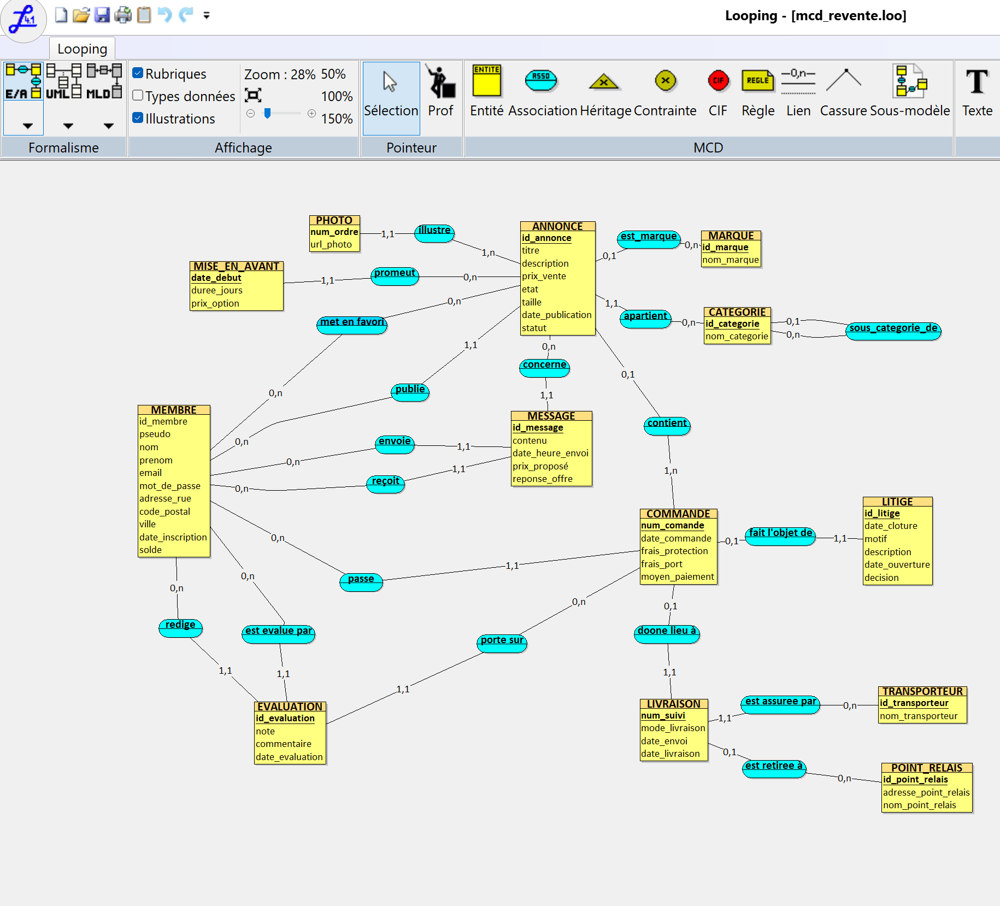

# Mini-projet Bases de données — Plateforme de revente entre particuliers

**Module :** TI503N – Bases de données 1 : Concepts de base (Efrei)

**Binôme :** JORESSE BRANDY FANGOUO TATSING – ROUA MIHRAB

**Méthode :** MERISE

 ## Sommaire

1. Présentation du projet
2. Étape 1 : analyse des besoins
   - Prompt utilisé
   - Règles de gestion
   - Dictionnaire de données
   - Analyse du résultat
3. Étape 2 : MCD
4. Partie 2 (à venir)
5. Organisation du dépôt


 ## 1. Présentation du projet

Nous concevons la base de données d'une entreprise qui exploite une plateforme web et mobile de revente d'articles d'occasion entre particuliers, sur le modèle de Vinted, Leboncoin ou Vestiaire Collective. Les membres y publient des annonces, échangent par messagerie, passent des commandes avec paiement sécurisé, se font livrer à domicile ou en point relais, puis s'évaluent mutuellement.

Le projet suit les étapes de la méthode MERISE :

| Partie | Étapes | Rendu |
|---|---|---|
| Partie 1 | 1. Analyse des besoins · 2. MCD | 16/10/26 |
| Partie 2 | 3. MLD et MPD · 4. Insertion des données · 5. Requêtes · 6. Vidéo | 09/11/26 |


## 2. Étape 1 : analyse des besoins

L'analyse des besoins a été réalisée avec une IA générative jouant le rôle de l'entreprise, à partir de la base de prompt fournie, complétée selon le framework RICARDO (ajout du **Contexte** et des **Références**).

### 2.1 Prompt utilisé

Le prompt est également disponible dans [`Prompts/prompt_analyse_besoins.txt`](Prompts/prompt_analyse_besoins.txt).

```text
Tu travailles dans le domaine du commerce en ligne de seconde main entre particuliers. Ton entreprise a comme activité d'exploiter une plateforme web et mobile de type marketplace, sur laquelle des particuliers inscrits mettent en vente des articles d'occasion (vêtements, chaussures, accessoires, articles pour la maison), discutent avec des acheteurs par messagerie, concluent des ventes avec paiement sécurisé via la plateforme, font livrer les articles par des transporteurs ou en point relais, puis s'évaluent mutuellement. Un même membre peut être à la fois vendeur et acheteur. L'entreprise se rémunère grâce à des frais de protection acheteur ajoutés à chaque commande et à des options payantes de mise en avant des annonces. C'est une entreprise comme Vinted, Leboncoin ou Vestiaire Collective. Les données ont été collectées sur les membres de la plateforme, les articles mis en vente et leurs annonces, les catégories et les marques, les photos des articles, les messages échangés entre membres, les commandes et les paiements, les livraisons et les points relais, les évaluations entre membres et les litiges. Inspire-toi des sites web suivants : https://www.vinted.fr (site principal), https://www.vinted.fr/help/550 (protection acheteurs), https://www.vinted.fr/help/342 (calcul des frais), https://www.leboncoin.fr et https://www.vestiairecollective.com.

Ton entreprise veut appliquer MERISE pour concevoir un système d'information. Tu es chargé de la partie analyse, c'est-à-dire de collecter les besoins auprès de l'entreprise. Elle a fait appel à un étudiant en ingénierie informatique pour réaliser ce projet, tu dois lui fournir les informations nécessaires pour qu'il applique ensuite lui-même les étapes suivantes de conception et développement de la base de données.

D'abord, établis les règles de gestions des données de ton entreprise, sous la forme d'une liste à puce. Elle doit correspondre aux informations que fournit quelqu'un qui connaît le fonctionnement de l'entreprise, mais pas comment se construit un système d'information.

Ensuite, à partir de ces règles, fournis un dictionnaire de données brutes avec les colonnes suivantes, regroupées dans un tableau : signification de la donnée, type, taille en nombre de caractères ou de chiffres. Il doit y avoir entre 25 et 35 données. Il sert à fournir des informations supplémentaires sur chaque donnée (taille et type) mais sans a priori sur comment les données vont être modélisées ensuite.

Fournis donc les règles de gestion et le dictionnaire de données.


**Éléments ajoutés à la base de prompt :**

- **Contexte :** domaine (commerce de seconde main entre particuliers), type de structure (entreprise), activité détaillée, modèle économique, exemples d'entreprises réelles (Vinted, Leboncoin, Vestiaire Collective), liste des sujets sur lesquels les données sont collectées, et précision qu'un membre peut être à la fois vendeur et acheteur.
- **Références :** pages du site Vinted (accueil, protection acheteurs, calcul des frais), Leboncoin et Vestiaire Collective.

### 2.2 Règles de gestion

Règles obtenues de l'IA, reproduites telles quelles.

#### Les membres

- **RG01** — Pour vendre ou acheter, une personne doit s'inscrire et devient membre. On lui demande un pseudo, son nom, son prénom, une adresse e-mail et un mot de passe. On enregistre la date de son inscription.
- **RG02** — Deux membres ne peuvent pas avoir le même pseudo ni la même adresse e-mail.
- **RG03** — Un membre renseigne une adresse postale (numéro et rue, code postal, ville). Elle est obligatoire pour recevoir un colis à domicile.
- **RG04** — Un même membre peut être vendeur, acheteur, ou les deux.
- **RG05** — L'argent de ses ventes est crédité sur un porte-monnaie (solde) lié à son compte. Il peut ensuite le virer sur son compte bancaire.

#### Les articles et les annonces

- **RG06** — Un membre met un article en vente en publiant une annonce. Chaque annonce concerne un seul article, et un seul membre en est le vendeur.
- **RG07** — Une annonce comporte un titre, une description, un prix de vente, l'état de l'article (neuf avec étiquette, neuf sans étiquette, très bon état, bon état, satisfaisant), une taille si c'est pertinent, et une date de publication.
- **RG08** — Une annonce a un statut : en ligne, réservée, vendue ou retirée.
- **RG09** — Chaque article d'occasion est unique et ne peut donc être vendu qu'une seule fois.
- **RG10** — Chaque article est rangé dans une seule catégorie. Les catégories sont emboîtées les unes dans les autres (par exemple Femmes > Vêtements > Robes).
- **RG11** — Un article peut être associé à une marque, mais ce n'est pas obligatoire. Une marque peut concerner de nombreux articles.
- **RG12** — Une annonce doit avoir au moins une photo et au maximum 20. La première photo sert de photo principale.
- **RG13** — Un membre peut ajouter des annonces d'autres membres à ses favoris.

#### La mise en avant (option payante)

- **RG14** — Un vendeur peut payer pour mettre une annonce en avant pendant une durée donnée, par exemple 3 ou 7 jours. On enregistre la durée, le prix payé et la date de début.
- **RG15** — Une même annonce peut être mise en avant plusieurs fois.

#### La messagerie

- **RG16** — Les membres échangent des messages au sujet d'une annonce précise. Chaque message a un expéditeur, un destinataire, un contenu, ainsi qu'une date et une heure d'envoi.
- **RG17** — Un acheteur peut proposer un prix inférieur par message. Le vendeur accepte ou refuse cette offre.

#### Les commandes et les paiements

- **RG18** — Une commande est passée par un seul acheteur auprès d'un seul vendeur. Elle peut regrouper plusieurs articles de ce vendeur (achat en lot).
- **RG19** — Chaque commande a un numéro unique et une date.
- **RG20** — Le montant payé par l'acheteur comprend trois éléments. Le premier est le prix des articles. Le deuxième est constitué des frais de protection acheteurs, composés d'une part fixe et d'un pourcentage du prix. Le troisième correspond aux frais de port.
- **RG21** — Le vendeur ne paie aucun frais sur sa vente. Il reçoit le prix des articles.
- **RG22** — L'acheteur paie obligatoirement via la plateforme, par carte bancaire, PayPal ou avec le solde de son porte-monnaie.
- **RG23** — L'argent reste bloqué par la plateforme. Il n'est versé au vendeur qu'une fois que l'acheteur a confirmé que tout est conforme, ou automatiquement 2 jours après la livraison si l'acheteur ne s'est pas manifesté.

#### Les livraisons

- **RG24** — Chaque commande donne lieu à un seul envoi. Il est confié à un transporteur (Mondial Relay, Colissimo, Relais Colis…) et se fait soit à domicile, soit en point relais.
- **RG25** — En point relais, l'acheteur choisit le point relais où il retirera son colis. On connaît le nom et l'adresse de ce point relais.
- **RG26** — Chaque envoi a un numéro de suivi. On enregistre la date d'envoi et la date de livraison.
- **RG27** — Le vendeur a 5 jours ouvrés pour expédier le colis. Passé ce délai, la commande est annulée et l'acheteur est remboursé.

#### Les évaluations

- **RG28** — Une fois la commande terminée, l'acheteur et le vendeur peuvent chacun évaluer l'autre. Une évaluation comprend une note de 1 à 5 étoiles, un commentaire facultatif et une date.
- **RG29** — Un membre ne peut laisser qu'une seule évaluation par commande.
- **RG30** — La note moyenne d'un membre est affichée sur son profil.

#### Les litiges

- **RG31** — L'acheteur peut ouvrir un litige dans les 2 jours qui suivent la livraison. Les motifs possibles sont : article non reçu, endommagé, non conforme à la description ou contrefaçon.
- **RG32** — Un litige concerne une seule commande, et une commande ne peut faire l'objet que d'un seul litige.
- **RG33** — Le litige comprend un motif, une description du problème et une date d'ouverture. Le service client le traite et rend une décision : remboursement total, remboursement partiel ou refus. On note ensuite la date de clôture.

### 2.3 Dictionnaire de données

Dictionnaire de données brutes obtenu de l'IA (35 données).

| N° | Signification de la donnée | Type | Taille |
|---|---|---|---|
| 1 | Pseudo du membre | Alphanumérique | 30 |
| 2 | Nom du membre | Alphabétique | 50 |
| 3 | Prénom du membre | Alphabétique | 50 |
| 4 | Adresse e-mail du membre | Alphanumérique | 100 |
| 5 | Adresse postale (numéro et rue) | Alphanumérique | 100 |
| 6 | Code postal | Alphanumérique | 5 |
| 7 | Ville | Alphabétique | 50 |
| 8 | Date d'inscription du membre | Date | 10 |
| 9 | Titre de l'annonce | Alphanumérique | 80 |
| 10 | Description de l'article | Alphanumérique | 2000 |
| 11 | Prix de vente de l'article (€) | Numérique | 7 (dont 2 décimales) |
| 12 | État de l'article | Alphabétique | 30 |
| 13 | Taille de l'article | Alphanumérique | 10 |
| 14 | Date de publication de l'annonce | Date | 10 |
| 15 | Statut de l'annonce | Alphabétique | 10 |
| 16 | Nom de la catégorie | Alphanumérique | 50 |
| 17 | Nom de la marque | Alphanumérique | 50 |
| 18 | Lien (URL) de la photo | Alphanumérique | 255 |
| 19 | Durée de la mise en avant (jours) | Numérique | 2 |
| 20 | Prix de l'option de mise en avant (€) | Numérique | 5 (dont 2 décimales) |
| 21 | Contenu du message | Alphanumérique | 1000 |
| 22 | Date et heure d'envoi du message | Date-heure | 19 |
| 23 | Numéro de la commande | Alphanumérique | 12 |
| 24 | Date de la commande | Date | 10 |
| 25 | Montant des frais de protection acheteurs (€) | Numérique | 6 (dont 2 décimales) |
| 26 | Montant des frais de port (€) | Numérique | 5 (dont 2 décimales) |
| 27 | Moyen de paiement | Alphabétique | 20 |
| 28 | Mode de livraison (domicile / point relais) | Alphabétique | 15 |
| 29 | Nom du transporteur | Alphanumérique | 30 |
| 30 | Numéro de suivi du colis | Alphanumérique | 30 |
| 31 | Nom du point relais | Alphanumérique | 80 |
| 32 | Note de l'évaluation (1 à 5) | Numérique | 1 |
| 33 | Commentaire de l'évaluation | Alphanumérique | 500 |
| 34 | Motif du litige | Alphabétique | 30 |
| 35 | Décision rendue sur le litige | Alphabétique | 30 |

**Remarques de l'IA :**

- Le code postal est en alphanumérique pour conserver le zéro initial (01000, par exemple).
- Le montant total d'une commande n'apparaît pas dans le dictionnaire, car c'est une donnée calculée à partir des données 11, 25 et 26.
- Les règles citent quelques informations absentes du dictionnaire (solde, date de livraison, date d'ouverture d'un litige, prix d'une offre). Elles en ont été écartées pour respecter la limite de 35 données.

### 2.4 Analyse du résultat

Nous avons vérifié l'adéquation de la réponse de l'IA avec les exigences du prompt.

| Critère | Résultat |
|---|---|
| Nombre de données entre 25 et 35 | ✅ 35 données |
| Règles de gestion sous forme de liste à puces | ✅ 33 règles, regroupées par thème |
| Dictionnaire en tableau (signification, type, taille) | ✅ |
| Tous les sujets du prompt sont couverts (membres, annonces, catégories, marques, photos, messages, commandes, paiements, livraisons, points relais, évaluations, litiges) | ✅ |
| Prise en compte des références (frais en part fixe + pourcentage, délai de réclamation de 2 jours) | ✅ |
| Types et tailles cohérents | ✅ |
| Toutes les données citées dans les règles figurent dans le dictionnaire | ⚠️ Non (voir ci-dessous) |

**Problème relevé :** en atteignant la limite de 35 données, l'IA a écarté plusieurs données pourtant citées dans ses propres règles de gestion. Elle en signale une partie dans ses remarques, mais pas toutes. Les données manquantes sont :

| Donnée manquante | Règle concernée | Signalée par l'IA |
|---|---|---|
| Mot de passe du membre | RG01 | Non |
| Solde du porte-monnaie | RG05 | Oui |
| Date de début de la mise en avant | RG14 | Non |
| Prix proposé dans une offre et réponse du vendeur | RG17 | En partie |
| Date d'envoi du colis | RG26 | Non |
| Date de livraison | RG26 | Oui |
| Adresse du point relais | RG25 | Non |
| Date de l'évaluation | RG28 | Non |
| Description du problème du litige | RG33 | Non |
| Date d'ouverture du litige | RG33 | Oui |
| Date de clôture du litige | RG33 | Non |

**Décision :** la réponse respectant toutes les exigences formulées dans le prompt, nous l'avons conservée sans la resoumettre. Une nouvelle soumission aurait obligé l'IA soit à dépasser 35 données, soit à appauvrir les règles de gestion. Le sujet autorisant l'ajout de données au MCD, **nous ajoutons ces données manquantes directement dans le MCD** afin qu'il soit cohérent avec l'ensemble des règles de gestion.


## 3. Étape 2 : MCD


Le MCD est réalisé avec **Looping** . Le fichier source se trouve dans ['mcd_revente.loo')et l'image du shéma se trouvent dans le dossier ['MCD /'](MCD/).



Il comporte **13 entités** (MEMBRE, ANNONCE, CATEGORIE, MARQUE, PHOTO, MISE_EN_AVANT, MESSAGE, COMMANDE, LIVRAISON, TRANSPORTEUR, POINT_RELAIS, EVALUATION, LITIGE) et **19 associations**. Il respecte la troisième forme normale : chaque attribut dépend uniquement de l'identifiant de son entité.

### 3.1 Éléments de modélisation avancée

- **Association récursive « sous_categorie_de »** sur CATEGORIE (RG10) : une catégorie peut être la sous-catégorie d'une catégorie mère (0,1), et une catégorie mère peut avoir plusieurs sous-catégories (0,n). Exemple : Femmes → Robes.
- **Entité faible PHOTO** (RG12) : une photo est identifiée par son numéro d'ordre *relativement à son annonce*. Le `num_ordre` seul n'est pas unique (chaque annonce a sa photo n°1) ; l'identifiant complet est le couple (id_annonce, num_ordre), d'où l'identifiant relatif (1,1) sur la patte « illustre ».
- **Entité faible MISE_EN_AVANT** (RG14-15) : une mise en avant est identifiée par sa date de début relativement à l'annonce promue. Une même annonce peut être mise en avant plusieurs fois, à des dates différentes.

### 3.2 Choix de modélisation

- **Annonce et article fusionnés** : un article correspond à une seule annonce et inversement (RG06). Deux entités reliées par une association 1,1–1,1 seraient redondantes ; nous avons donc gardé une seule entité ANNONCE.
- **Pas de lien direct entre la commande et le vendeur** : le vendeur se retrouve à partir des annonces contenues dans la commande. Un lien supplémentaire aurait créé une redondance.
- **Données calculées non stockées** : le montant total d'une commande (RG20) et la note moyenne d'un membre (RG30) se calculent à partir des autres données ; les stocker créerait un risque d'incohérence.
- **Cardinalité 0,1 côté ANNONCE dans « contient »** : un article ne peut être vendu qu'une seule fois (RG09).
- **Ternaire écartée pour EVALUATION** : comme un membre ne peut évaluer qu'une fois par commande (RG29), le membre évalué se déduit de la commande. Une association ternaire aurait été décomposable ; nous avons préféré trois associations binaires (« rédige », « est évalué par », « porte sur »).
- **Ville et code postal gardés dans MEMBRE** : il n'existe pas de dépendance fonctionnelle stricte entre les deux (un code postal peut couvrir plusieurs communes), donc la 3FN reste respectée.
- **Données ajoutées par rapport au dictionnaire** : les données citées dans les règles de gestion mais absentes du dictionnaire (voir section 2.4) ont été intégrées au MCD, par exemple `mot_de_passe`, `solde`, `prix_propose`, `date_envoi` ou `date_evaluation`.


## 4. Partie 2 (à venir)

Étapes 3 à 6 : MLD et MPD en SQL, insertion des données, requêtes, vidéo de présentation.


## 5. Organisation du dépôt

```text
ProjetDB_fangouo_mihrab/
├── README.md                          Documentation du projet
├── Prompts/
│   └── prompt_analyse_besoins.txt     Prompt de l'analyse des besoins
└── MCD/                               (à venir) Fichier source et image du MCD
```
